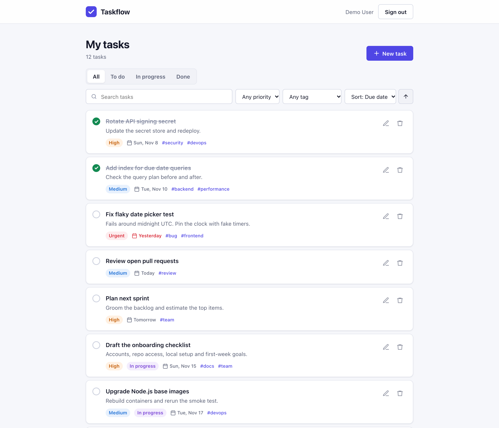
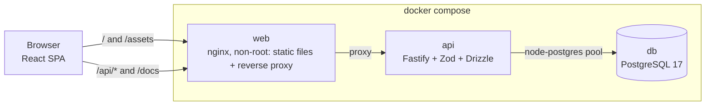
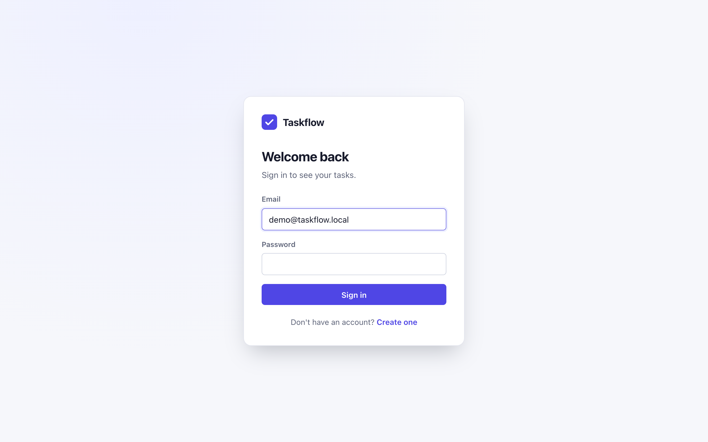
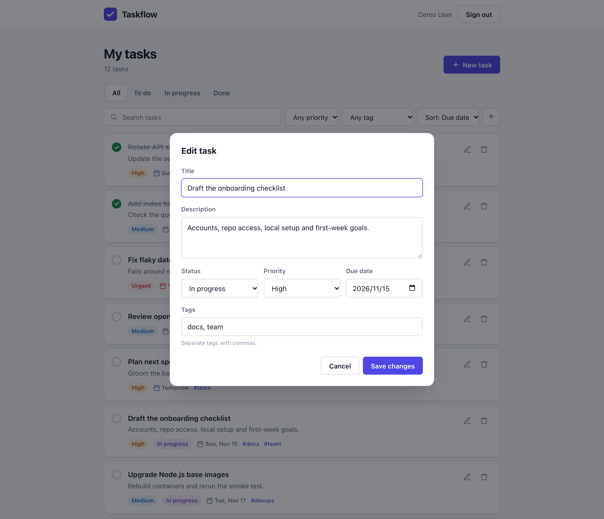
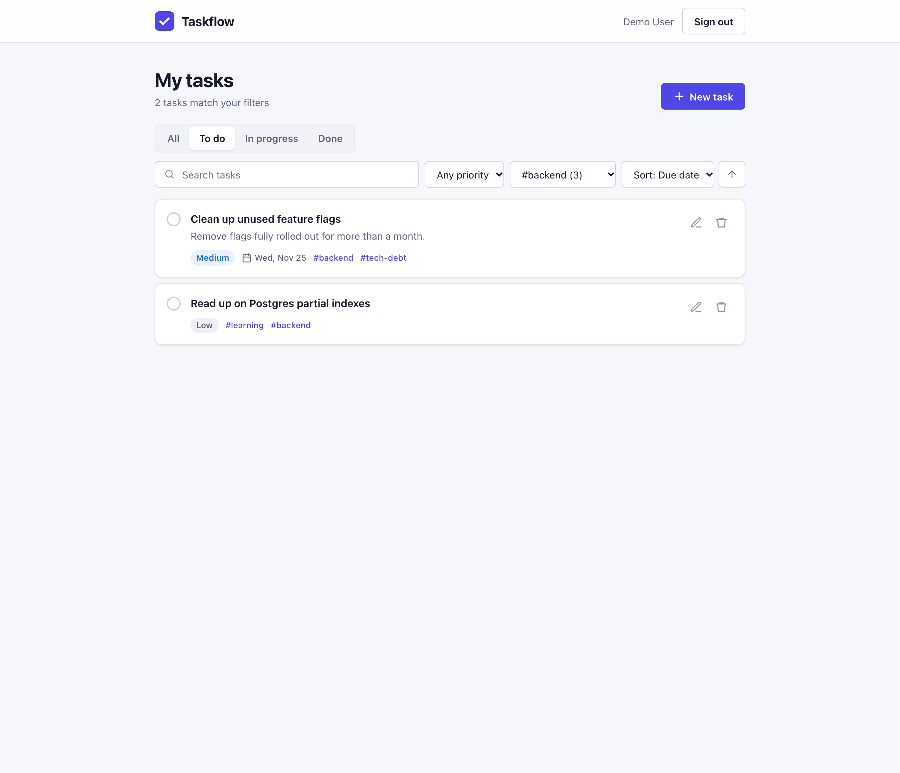
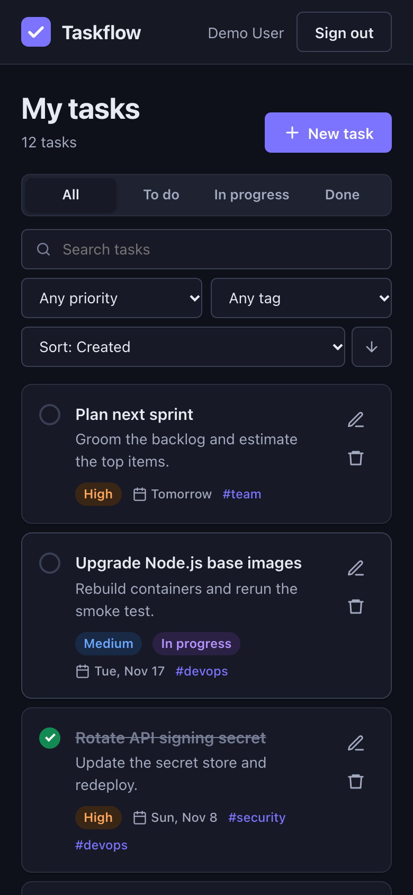

# Taskflow

[](https://github.com/Francorider/taskflow-api/actions/workflows/ci.yml)
[](LICENSE)

A full stack TypeScript task manager: a REST API built with **Fastify, Zod, Drizzle ORM and PostgreSQL**, and a **React + Vite** client. Tasks have due dates, priorities and tags, and the list supports filtering, case-insensitive search, sorting and pagination. Auth is stateless JWT.

The goal of the project is to show how I structure a small production-style service end to end: validated input at the edge, a typed data layer, consistent errors, real integration tests against Postgres, a one-command Docker setup and a CI pipeline that proves all of it on every push.



## Contents

- [Features](#features)
- [Quick start](#quick-start)
- [Architecture](#architecture)
- [Design decisions and trade-offs](#design-decisions-and-trade-offs)
- [Local development](#local-development)
- [Testing](#testing)
- [API summary](#api-summary)
- [Screenshots](#screenshots)
- [Deployment](#deployment)
- [Project layout](#project-layout)
- [Author](#author)

## Features

- **Tasks:** create, read, update (partial `PATCH`), delete. Title, description, status (`todo`, `in_progress`, `done`), priority (`low` to `urgent`), optional due date and up to 10 tags.
- **Querying:** filter by status, priority, tags (must match all), due date range and a case-insensitive search over title and description. Sort by created, updated, due date, priority or title. Offset pagination with total counts.
- **Auth:** register, log in, `GET /me`. bcrypt password hashing, JWT bearer tokens, rate-limited auth endpoints, and per-user data isolation on every query.
- **API docs:** OpenAPI 3.1 generated from the same Zod schemas that validate requests, served with Swagger UI at `/docs` and committed to [`docs/openapi.json`](docs/openapi.json).
- **Client:** responsive React UI with status tabs, filters, debounced search, inline completion toggling, a create/edit dialog, light and dark themes, and accessible labels throughout.
- **Ops:** multi-stage Docker images, Docker Compose for the full stack, health checks, graceful shutdown, structured JSON logs, and GitHub Actions CI.

## Quick start

Requirements: Docker with the Compose plugin.

```bash
git clone https://github.com/Francorider/taskflow-api.git
cd taskflow-api
docker compose up --build
```

| URL                        | What                            |
| -------------------------- | ------------------------------- |
| http://localhost:8080      | Web app                         |
| http://localhost:8080/docs | Swagger UI (proxied to the API) |
| http://localhost:3000/api  | API, directly                   |

On first start the API container applies database migrations and seeds a **local demo account** so there is something to look at:

- Email: `demo@taskflow.local`
- Password: `demo-password`

You can also register your own account from the sign-in screen. Set `SEED_DEMO_DATA=false` to skip the demo data, and override `JWT_SECRET` for anything other than local use. Ports can be changed with `WEB_PORT`, `API_PORT` and `POSTGRES_PORT`.

## Architecture



The browser only ever talks to one origin. nginx serves the built client and forwards `/api` and `/docs` to the API container, so there is no CORS in the Docker setup and no API URL baked into the client bundle. In local development the Vite dev server plays the same proxy role.

Inside the API, each feature is a module with the same three layers:

```
routes  ->  service  ->  database
(HTTP: schemas, status codes)   (business rules, ownership)   (Drizzle queries)
```

- **Routes** declare Zod schemas for params, query, body and every response. `fastify-type-provider-zod` uses them to validate input, to type `request.body` / `request.query` without casts, to serialise output (unknown fields such as `passwordHash` are stripped even if a handler passed them by mistake) and to generate the OpenAPI document.
- **Services** are plain classes that receive the database handle in their constructor. They know nothing about HTTP and throw typed errors (`NotFoundError`, `ConflictError`, ...).
- **A single error handler** turns those errors, validation failures and framework errors into one response shape:

  ```json
  { "error": { "code": "VALIDATION_ERROR", "message": "Request validation failed", "details": [ ... ] } }
  ```

  Unexpected errors are logged with the request id and returned as a generic 500, so internals never leak.

`buildApp({ config, db })` constructs the whole application from injected dependencies. The server entry point, the integration tests and the OpenAPI export script all use it, so tests exercise the real plugin stack, not a mock of it.

## Design decisions and trade-offs

**Fastify over Express.** Schema-first routes, built-in request logging with Pino, encapsulated plugins and good TypeScript support. Express would have worked, but would need more glue for validation, typing and docs.

**Zod as the single source of truth.** One schema per payload drives runtime validation, static types and OpenAPI. The cost is coupling the docs to a third-party type provider; the benefit is that the docs cannot drift from the code, and CI fails if the committed `docs/openapi.json` is stale.

**Drizzle over Prisma.** Drizzle is a thin, typed SQL builder with no separate query engine binary, which keeps the Docker image simple and the generated SQL predictable. Migrations are generated SQL files committed to the repo (`apps/api/drizzle/`) and applied on container start. The trade-off is a smaller ecosystem and less hand-holding than Prisma.

**Tags as a Postgres `text[]` column** with a GIN index, rather than a `tags` table and a join table. Tags here are lightweight labels owned by one task, so an array keeps reads to a single row, and `@>` (array contains) gives an indexed "has all of these tags" filter. A join table would be the better choice if tags needed their own metadata (colours, renames across all tasks) or cross-user sharing.

**Priority as a Postgres enum** declared in severity order. Postgres sorts enum values by declaration order, so `ORDER BY priority` is low to urgent with no `CASE` expression.

**Due dates are calendar dates (`date`), not timestamps.** "Due on 14 March" should not shift with the viewer's time zone. The client decides what "overdue" means using the user's local today.

**Offset pagination** (`page` and `pageSize`, max 100) with a total count. It is simple, supports "page X of Y" and fits per-user task lists. Every sort has `created_at` and `id` as tie-breakers so pages are stable. For very large or fast-changing lists, keyset (cursor) pagination would avoid the cost of large offsets and the count query.

**Search is `ILIKE` with escaped wildcards.** Correct and good enough for per-user data volumes; user input like `100%` is matched literally. At larger scale I would add a `pg_trgm` index or Postgres full-text search.

**Ownership is enforced in the query, not after it.** Every lookup is scoped by `user_id`, and another user's task returns `404`, not `403`, so ids do not reveal what exists.

**Stateless JWT auth, no refresh tokens.** Simple to run and scale horizontally. The trade-off is that a token cannot be revoked before it expires (default 12 hours). A production system with stricter requirements would add short-lived access tokens plus rotating refresh tokens, or server-side sessions.

**Token stored in `localStorage` on the client.** Straightforward, and it avoids CSRF since the token is sent explicitly in a header. The cost is exposure to XSS; React's escaping and the absence of `dangerouslySetInnerHTML` reduce that risk, and an `httpOnly` cookie would be the stricter alternative.

**Login does not reveal which emails exist.** Wrong password and unknown email return the same 401, and an unknown email still runs a bcrypt comparison so response times match. Auth routes are rate-limited per IP.

**Database clock for timestamps.** `created_at` and `updated_at` both come from Postgres `now()`. An early version set `updated_at` from the Node process clock, and the integration tests caught it producing an `updated_at` earlier than `created_at` when the two clocks disagreed.

**Shared types between client and API are not generated.** The client has small hand-written types in `apps/web/src/api/types.ts`. For a project this size that is simpler than a shared package or a code generation step; with more endpoints I would generate a typed client from `docs/openapi.json`.

**Integration tests use a real Postgres**, not mocks or SQLite. Filtering, sorting, enum ordering and array operators are exactly the kind of behaviour mocks get wrong.

## Local development

Requirements: Node.js 22+ and Docker (for Postgres).

```bash
npm install
docker compose up -d db                     # Postgres on localhost:5432
cp apps/api/.env.example apps/api/.env      # then set JWT_SECRET
npm run db:migrate -w apps/api
npm run db:seed -w apps/api                 # optional demo data
npm run dev -w apps/api                     # http://localhost:3000, docs at /docs
npm run dev -w apps/web                     # http://localhost:5173, proxies /api and /docs to :3000
```

Root scripts run across both workspaces:

| Script                 | What it does                                  |
| ---------------------- | --------------------------------------------- |
| `npm run lint`         | ESLint (type-aware `strictTypeChecked` rules) |
| `npm run format:check` | Prettier check                                |
| `npm run typecheck`    | `tsc` for both apps                           |
| `npm test`             | All unit, integration and component tests     |
| `npm run build`        | Production builds of the API and the client   |

Swagger UI is then available at http://localhost:5173/docs (through the Vite proxy) or directly at http://localhost:3000/docs.

API-specific: `db:generate` creates a new migration from schema changes, and `openapi` regenerates `docs/openapi.json`.

### Configuration

The API validates its environment with Zod at startup and refuses to boot with a readable message if anything is wrong.

| Variable              | Default                 | Notes                                                                                       |
| --------------------- | ----------------------- | ------------------------------------------------------------------------------------------- |
| `DATABASE_URL`        | (required)              | `postgres://` connection string                                                             |
| `JWT_SECRET`          | (required)              | At least 32 characters                                                                      |
| `JWT_EXPIRES_IN`      | `12h`                   | Any duration `@fastify/jwt` accepts                                                         |
| `PORT` / `HOST`       | `3000` / `0.0.0.0`      |                                                                                             |
| `CORS_ORIGIN`         | `http://localhost:5173` | Comma-separated list                                                                        |
| `LOG_LEVEL`           | `info`                  | Pino level                                                                                  |
| `BCRYPT_ROUNDS`       | `12`                    | Lowered to 4 in tests for speed                                                             |
| `AUTH_RATE_LIMIT_MAX` | `20`                    | Requests per minute per IP on auth routes                                                   |
| `TRUST_PROXY`         | `0`                     | Number of reverse proxies in front of the API; set so rate limiting sees the real client IP |

## Testing

```bash
docker compose up -d db
npm test
```

- **API unit tests** (`apps/api/test/unit`): pure logic such as tag normalisation, `LIKE` escaping, pagination maths, config parsing and the request schemas.
- **API integration tests** (`apps/api/test/integration`): Vitest and Supertest against the real Fastify app and a real Postgres database. They cover registration and login edge cases, token handling, CRUD, cross-user isolation, every filter, sort order (including nulls-last due dates and enum priority order), pagination and the OpenAPI endpoint. A global setup creates the `taskflow_test` database if needed and runs migrations; each test starts from truncated tables.
- **Client tests** (`apps/web/src/**/*.test.ts(x)`): Vitest, Testing Library and jsdom. Form validation and submission, task item behaviour, filter interactions, the API client, date helpers, and the full sign-in flow with `fetch` mocked at the network boundary.

Run only the database-free API tests with `npm run test:unit -w apps/api`. Point the integration tests at another database with `TEST_DATABASE_URL`.

### Continuous integration

[`.github/workflows/ci.yml`](.github/workflows/ci.yml) runs on every push and pull request:

1. **Quality:** Prettier, ESLint, `tsc`, and a check that `docs/openapi.json` matches the code.
2. **Test:** the full test suite with a Postgres service container.
3. **Build:** production builds of both apps.
4. **Docker:** builds the images, starts the whole stack with `docker compose up --wait`, then signs in as the demo user through the nginx proxy and fetches tasks.

## API summary

All task routes require `Authorization: Bearer <token>`. Full schemas are in Swagger UI at `/docs` and in [`docs/openapi.json`](docs/openapi.json).

| Method   | Path                 | Description                                  |
| -------- | -------------------- | -------------------------------------------- |
| `POST`   | `/api/auth/register` | Create an account, returns `{ token, user }` |
| `POST`   | `/api/auth/login`    | Log in, returns `{ token, user }`            |
| `GET`    | `/api/auth/me`       | Current user                                 |
| `GET`    | `/api/tasks`         | List tasks (filters below)                   |
| `POST`   | `/api/tasks`         | Create a task                                |
| `GET`    | `/api/tasks/{id}`    | Get a task                                   |
| `PATCH`  | `/api/tasks/{id}`    | Update any subset of fields                  |
| `DELETE` | `/api/tasks/{id}`    | Delete a task (`204`)                        |
| `GET`    | `/api/tags`          | Tags in use with task counts                 |
| `GET`    | `/api/health`        | Liveness and database check (`200` or `503`) |

`GET /api/tasks` query parameters:

| Parameter          | Example                  | Notes                                                    |
| ------------------ | ------------------------ | -------------------------------------------------------- |
| `page`, `pageSize` | `page=2&pageSize=20`     | Defaults 1 and 20, `pageSize` max 100                    |
| `status`           | `in_progress`            | `todo`, `in_progress`, `done`                            |
| `priority`         | `urgent`                 | `low`, `medium`, `high`, `urgent`                        |
| `tags`             | `bug,frontend`           | Task must have every listed tag                          |
| `search`           | `release notes`          | Case-insensitive, title or description                   |
| `dueFrom`, `dueTo` | `2030-01-01`             | Inclusive `YYYY-MM-DD` range                             |
| `sort`, `order`    | `sort=dueDate&order=asc` | `createdAt`, `updatedAt`, `dueDate`, `priority`, `title` |

Example:

```bash
TOKEN=$(curl -s -X POST localhost:3000/api/auth/login \
  -H 'Content-Type: application/json' \
  -d '{"email":"demo@taskflow.local","password":"demo-password"}' | jq -r .token)

curl -s -X POST localhost:3000/api/tasks \
  -H "Authorization: Bearer $TOKEN" -H 'Content-Type: application/json' \
  -d '{"title":"Write release notes","priority":"high","dueDate":"2030-01-31","tags":["docs"]}'

curl -s "localhost:3000/api/tasks?tags=docs&sort=dueDate&order=asc" -H "Authorization: Bearer $TOKEN"
```

```json
{
  "data": [
    {
      "id": "6f0b1c2e-...",
      "title": "Write release notes",
      "description": "",
      "status": "todo",
      "priority": "high",
      "dueDate": "2030-01-31",
      "tags": ["docs"],
      "createdAt": "...",
      "updatedAt": "..."
    }
  ],
  "meta": { "page": 1, "pageSize": 20, "total": 1, "totalPages": 1 }
}
```

## Screenshots

| Sign in                                  | Edit dialog                                  |
| ---------------------------------------- | -------------------------------------------- |
|  |  |

| Filtered by tag and status                      | Mobile, dark theme                                                               |
| ----------------------------------------------- | -------------------------------------------------------------------------------- |
|  |  |

## Deployment

[`render.yaml`](render.yaml) is a [Render Blueprint](https://render.com/docs/infrastructure-as-code) that provisions the hosted demo on free instance types:

- **taskflow-db:** managed PostgreSQL.
- **taskflow-api:** the same API Docker image used by Compose. Migrations and the demo seed run on start, `JWT_SECRET` is generated by Render, and `TRUST_PROXY=1` accounts for Render's load balancer.
- **taskflow-web:** the client built as a static site, calling the API at its own URL (`VITE_API_URL`) with CORS restricted to the site's origin, and a rewrite to `index.html` for client-side routes.

To deploy your own copy: Render Dashboard, **New > Blueprint**, connect the repository, then **Deploy Blueprint**. If Render gives the services different `onrender.com` names, update `CORS_ORIGIN` and `VITE_API_URL` in `render.yaml` to match.

Free-tier caveats, per [Render's docs](https://render.com/docs/free): the API spins down after 15 minutes without traffic, so the first request after a pause takes around a minute, and a free database expires 30 days after creation unless it is upgraded.

## Project layout

```
.
├── apps/
│   ├── api/                  Fastify REST API
│   │   ├── drizzle/          Generated SQL migrations
│   │   ├── scripts/          OpenAPI export
│   │   ├── src/
│   │   │   ├── db/           Schema, connection pool, migrator
│   │   │   ├── lib/          Errors, pagination, shared schemas
│   │   │   ├── modules/      auth, tasks, health (routes, schemas, service)
│   │   │   ├── plugins/      JWT auth, error handler
│   │   │   ├── app.ts        buildApp(): the composed application
│   │   │   └── server.ts     Process entry point
│   │   └── test/             Unit and integration tests
│   └── web/                  React + Vite client
│       └── src/
│           ├── api/          Typed fetch client and endpoints
│           ├── auth/         Auth context and provider
│           ├── components/   UI components (+ tests)
│           ├── lib/          Date, tag and error helpers
│           └── pages/        Sign-in and task pages
├── docs/                     OpenAPI spec and screenshots
├── docker-compose.yml
├── render.yaml               Render Blueprint for the hosted demo
└── .github/workflows/ci.yml
```

## Author

**Francois Viljoen** ([francois.viljoen.solutions@gmail.com](mailto:francois.viljoen.solutions@gmail.com))

A personal portfolio project, built independently and not affiliated with any employer.

## License

[MIT](LICENSE) © Francois Viljoen
